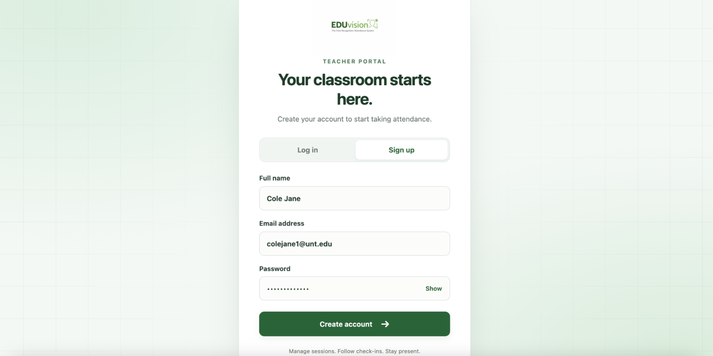
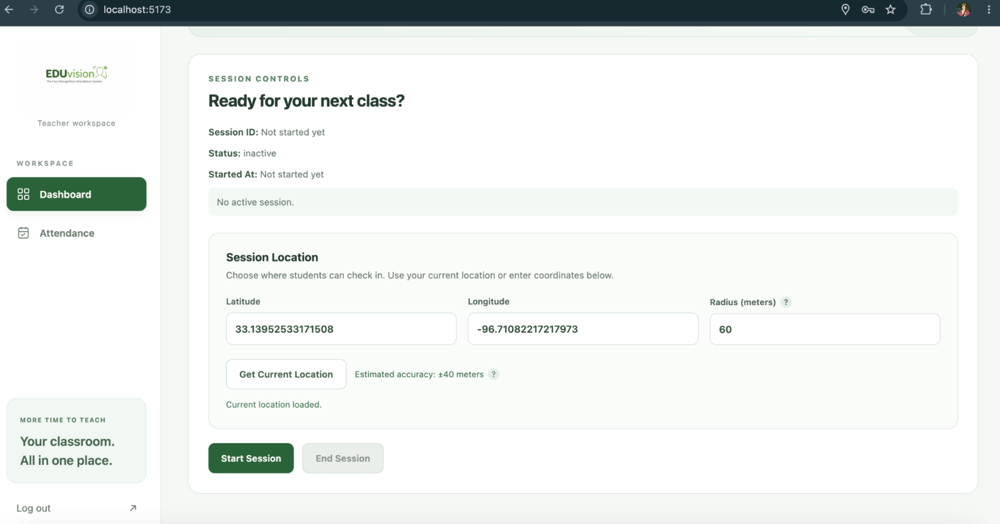
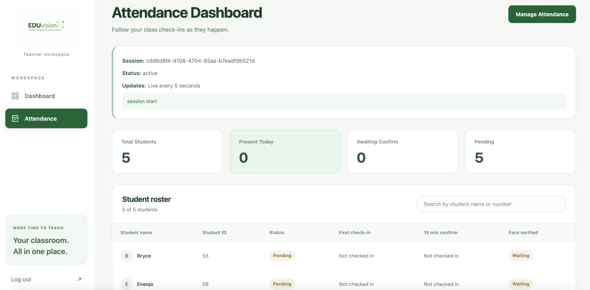
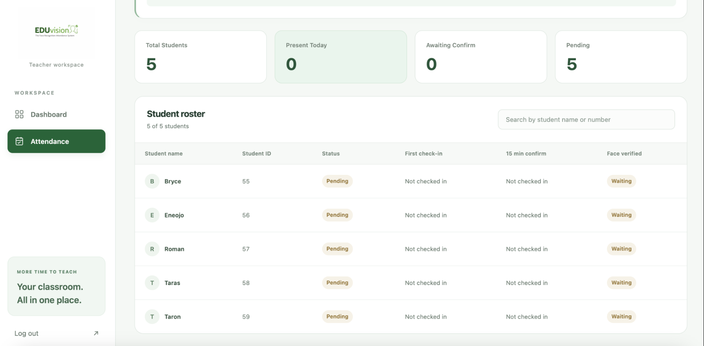
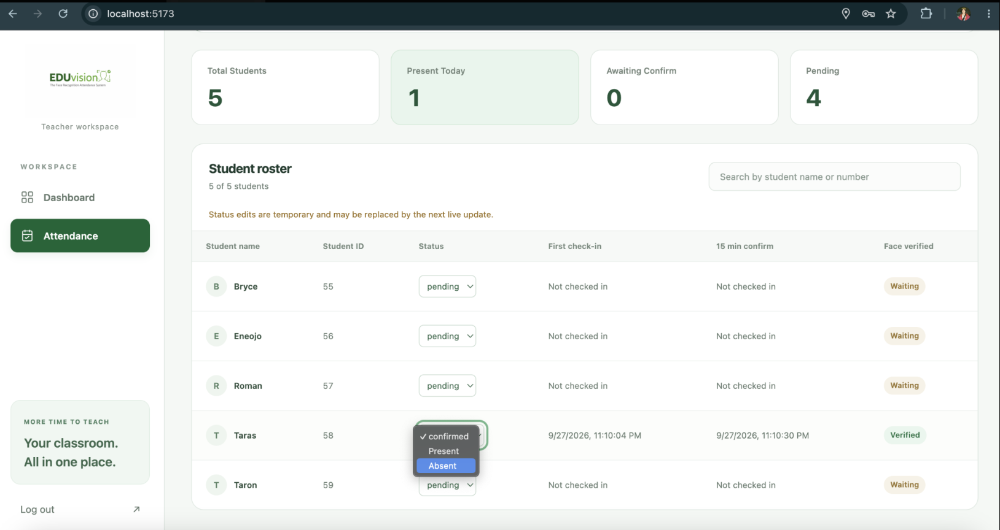
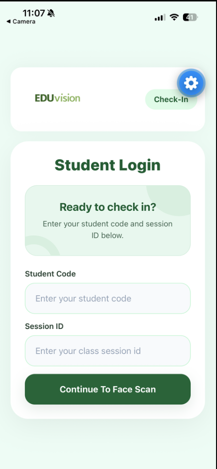
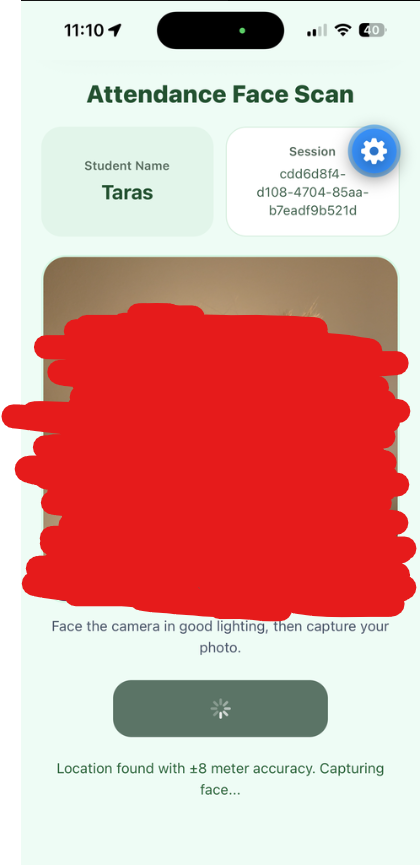
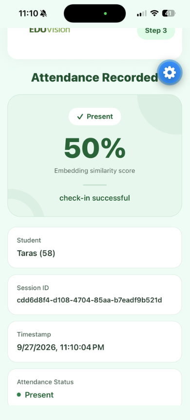

# EduVision – User Manual

**Version:** 2.0
**Team Number:** Team 15
**Team Name:** EdgeVision
**Date:** 10/02/2026

---

## 1. Introduction

EduVision is an attendance system made for students and instructors. Instructors can start a class session and see student attendance from the teacher website. Students use the mobile app to enter their Student Code and Session ID, then complete a face scan to check in.

The goal of EduVision is to make attendance faster, easier to manage, and more reliable than taking attendance by hand.

---

## 2. System Requirements

### Teacher Portal

- A laptop or desktop computer
- Google Chrome, Microsoft Edge, or Mozilla Firefox
- Internet connection
- Location access if using **Get Current Location**
- An EduVision teacher account

### Student App

- Android or iPhone
- Working front camera
- Internet connection
- Camera permission enabled
- Location permission enabled
- Student Code
- Session ID from the instructor

EduVision is currently a school project and prototype. The teacher website and student app connect to the EduVision backend and database automatically, so normal users do not need to set those up.

---

## 3. Installation Guide

### Teacher Portal

1. No installation is needed for the teacher website.
2. Open Chrome, Edge, or Firefox.
3. Open the EduVision Teacher Portal link provided by the team.
4. If you are new, select **Sign up** and create an account.
5. If you already have an account, select **Log in**.
6. After signing in, the teacher dashboard will open.

### Student App

1. Install or open the EduVision mobile app provided by the team.
2. Allow camera access.
3. Allow location access.
4. Make sure the phone is connected to the internet.
5. Get your Student Code and Session ID before checking in.

---

## 4. Getting Started

### Instructor

1. Open the EduVision Teacher Portal.
2. Log in or create an account.
3. Go to the **Dashboard**.
4. Set the class location.
5. Choose the check-in radius.
6. Select **Start Session**.
7. Give the Session ID to the students.
8. Open **Attendance** to watch student check-ins.

### Student

1. Open the EduVision mobile app.
2. Enter your Student Code.
3. Enter the Session ID from your instructor.
4. Select **Continue To Face Scan**.
5. Make sure you are inside the allowed class area.
6. Face the camera in good lighting.
7. Wait for the app to finish the face scan.
8. If successful, the app will show **Attendance Recorded**.

---

## 5. Features & Functions

### Feature 1: Teacher Account and Session Setup

Teachers use the web portal to create an account and start attendance sessions.

#### Create an Account

1. Open the Teacher Portal.
2. Select **Sign up**.
3. Enter your full name.
4. Enter your email.
5. Create a password.
6. Select **Create account**.
7. Log in after your account is created.

#### Start a Session

1. Open the **Dashboard**.
2. Find **Session Controls**.
3. Select **Get Current Location** or enter the latitude and longitude yourself.
4. Enter the check-in radius in meters.
5. Select **Start Session**.
6. The system will create a Session ID.
7. Give the Session ID to your students.
8. When attendance is finished, select **End Session**.

---

### Feature 2: Attendance Dashboard

The Attendance page lets the instructor see student check-ins and attendance status.

1. Select **Attendance** from the menu.
2. Make sure the correct session is shown.
3. Review the summary at the top:
   - Total Students
   - Present Today
   - Awaiting Confirm
   - Pending
4. Scroll down to see the student roster.
5. Use the search box if you need to find a student quickly.

#### Change a Student's Attendance

If the instructor needs to correct a student's status:

1. Find the student in the roster.
2. Select the current attendance status.
3. Choose the correct status from the list.
4. Make sure the new status appears in the roster.

---

### Feature 3: Student Check-In and Face Scan

Students use the mobile app to join the session and complete the attendance check-in.

#### Enter Student Code and Session ID

1. Open the EduVision app.
2. Enter your **Student Code**.
3. Enter the **Session ID** from your instructor.
4. Select **Continue To Face Scan**.

If the Session ID does not work, check the number and make sure the instructor's session is still active.

#### Complete the Face Scan

1. Make sure location access is turned on.
2. Stay inside the class check-in area.
3. Face the camera.
4. Use good lighting.
5. Wait while the app scans your face.
6. Do not close the app while it is processing.
7. If the scan fails, follow the message on the screen and try again.

#### Attendance Result

If the scan works, the app shows an **Attendance Recorded** screen. It includes the student's name, Session ID, time, attendance status, and face match result.

The instructor's Attendance page will also update after the student's check-in.

---

## 6. Troubleshooting

| Problem | Possible Cause | What to Do |
|---|---|---|
| Student cannot join the session | Wrong Session ID or the session is not active | Check the Session ID and ask the instructor if the session is active |
| Face scan does not work | Poor lighting or the face is not clear | Move to better lighting, face the camera, and try again |
| Location cannot be found | Location permission is off | Turn on Location Services and allow EduVision to use your location |
| Student is outside the allowed area | The phone is outside the instructor's check-in radius | Move closer to the classroom and try again |
| Teacher cannot start a session | Location information is missing | Use **Get Current Location** or enter valid coordinates and a radius |
| Attendance does not update right away | The page may still be refreshing | Wait a few seconds and check again |
| Camera does not open | Camera permission is off | Allow camera access in the phone settings and reopen the app |
| Manual attendance change disappears | A later live update replaced the temporary change | Check the latest status and update it again if needed |

---

## 7. Contact Information

If you need help with EduVision, contact Team EdgeVision.

- **Support Email:** tarasglushko@my.unt.edu
- **Project Repository:** https://github.com/Ivan1337-prg/EduVision
- **Team:** EdgeVision – Team 15
- **Organization:** University of North Texas

When asking for help, include:
- Whether you were using the teacher website or student app
- What you were trying to do
- What went wrong
- A screenshot if possible

---

## 8. FAQ

### Q1: Where do students get the Session ID?

**A:** The instructor starts a session from the Teacher Dashboard and gives the Session ID to the students.

### Q2: Why does EduVision need location access?

**A:** EduVision checks that the student is inside the class attendance area before allowing check-in.

### Q3: What should I do if my face scan does not work?

**A:** Use good lighting, face the camera directly, and try again. If it still does not work, ask the instructor for help.

### Q4: Can students use a QR code to join?

**A:** No. EduVision uses a Student Code and Session ID.

### Q5: Can an instructor change a student's attendance?

**A:** Yes. The instructor can update the student's status from the Attendance page.

### Helpful Tips

- Start the session before giving students the Session ID.
- Students should turn on camera and location permissions before checking in.
- Use good lighting for the face scan.
- Instructors should check the roster before ending the session.
- If a status looks wrong, wait a few seconds for the page to refresh before changing it again.
